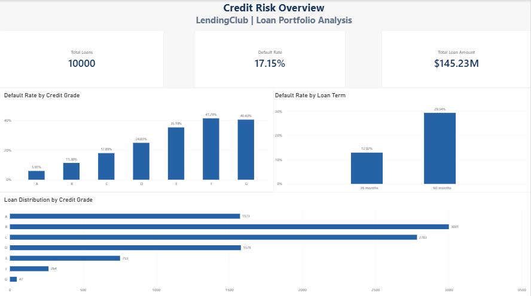
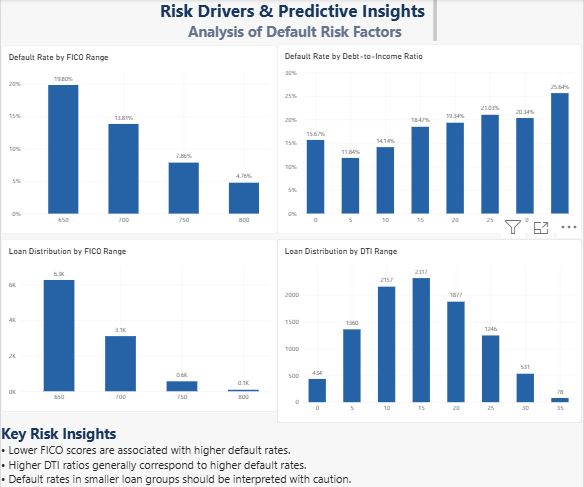
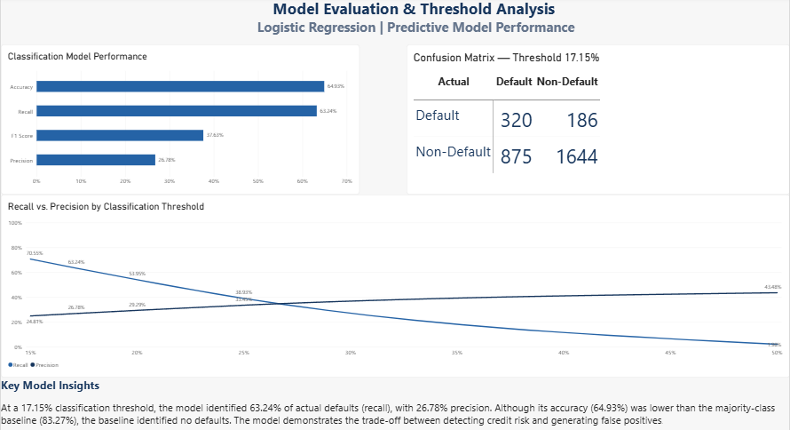
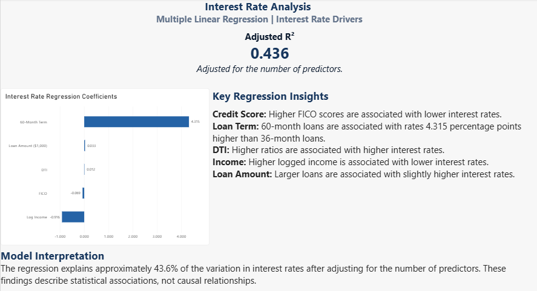

# LendingClub Credit Risk Analysis

**Credit Risk Assessment | Logistic Regression | Interest Rate Analysis | Power BI**

## Project Overview

I developed this project to analyze credit risk patterns in a sample of 10,000 LendingClub loans, evaluate a loan default classification model, and investigate the factors associated with loan interest rates.

Using Microsoft Excel, Power Query, and Power BI, I combined statistical analysis, predictive modeling, and interactive dashboards to translate financial data into business insights.

## Tools & Techniques

- **Microsoft Excel:** Statistical analysis, regression modeling, and model evaluation

- **Power Query:** Data preparation and transformation

- **Power BI:** Interactive dashboard development

- **Logistic Regression:** Default probability estimation

- **Multiple Linear Regression:** Interest rate analysis

- **Model Evaluation:** Confusion matrix, accuracy, recall, precision, F1 score, and classification threshold analysis

## Dataset Overview

### Data Source

George, N. (2019). *All Lending Club Loan Data* [Dataset]. Kaggle.

[View the original dataset on Kaggle](https://www.kaggle.com/datasets/wordsforthewise/lending-club)

The analysis uses 10,000 historical LendingClub loans issued between 2012 and 2014.

The sample includes loans with two final statuses:

- **Fully Paid:** Non-default (Default_Flag = 0)

- **Charged Off:** Default (Default_Flag = 1)

The dataset includes loan amounts, credit grades, FICO scores, debt-to-income ratios, annual income, interest rates, and loan terms.

### Portfolio Summary

| Metric | Result |
|---|---:|
| Total Loans | 10,000 |
| Total Loan Amount | $145.23 million |
| Overall Default Rate | 17.15% |
| 36-Month Default Rate | 12.92% |
| 60-Month Default Rate | 29.34% |

## Power BI Dashboard

### 1. Credit Risk Overview



This dashboard presents portfolio-level metrics, loan distributions, and default rates across credit grades and loan terms.

**Key finding:** The observed default rate for 60-month loans was 29.34%, compared with 12.92% for 36-month loans.

### 2. Risk Drivers & Predictive Insights



This dashboard explores relationships between borrower characteristics and loan default risk.

**Key findings:**

- Lower FICO scores are associated with higher observed default rates.

- Higher debt-to-income ratios generally correspond to greater default risk.

- Credit grades help distinguish borrower groups with different risk profiles.

## Logistic Regression Model

### Model Development

I developed a logistic regression model to estimate the probability of loan default using six predictors:

1.	FICO score

2. Debt-to-income ratio (DTI)
3. Log-transformed annual income
4. Loan amount
5. Loan term (60-month indicator)
6. Interest rate

The model calculates predicted default probabilities using the logistic function. The Excel workbook contains the model coefficients and a training-set log-likelihood calculation.

### Training and Testing

I used a random-number-based rule to divide the analytical sample into training and test sets.

| Dataset | Loans | Percentage |
|---|---:|---:|
| Training | 6,975 | 69.75% |
| Testing | 3,025 | 30.25% |

The recorded random-number values and dataset assignments are preserved in the workbook.

I evaluated classification performance on the separate test set.

### Classification Threshold

I used **17.15%**, matching the overall portfolio default rate, as the classification threshold for the main evaluation.

Loans with predicted default probabilities at or above this threshold were classified as predicted defaults.

I also evaluated alternative thresholds to understand how classification decisions affect recall, precision, and the volume of loans flagged for review.

### 3. Model Evaluation & Threshold Analysis



#### Confusion Matrix — Test Set

| Actual / Predicted | Default | Non-default |
|---|---:|---:|
| Actual Default | 320 | 186 |
| Actual Non-default | 875 | 1,644 |

#### Model Performance

| Metric | Result |
|---|---:|
| Accuracy | 64.93% |
| Recall | 63.24% |
| Precision | 26.78% |
| F1 Score | 37.63% |
| Majority-Class Baseline Accuracy | 83.27% |
| Classification Threshold | 17.15% |

The test-set default rate was 16.73%, compared with 17.15% for the full portfolio.

#### Classification Threshold Comparison

| Threshold | Recall | Precision | Loans Flagged |
|---|---:|---:|---:|
| 15.00% | 70.55% | 24.81% | 47.57% |
| 17.15% | 63.24% | 26.78% | 39.50% |
| 25.00% | 38.93% | 33.45% | 19.47% |

Lower thresholds increase the proportion of defaults identified but also increase the number of non-defaulting loans flagged for review.

Higher thresholds reduce review volume and improve precision, but more actual defaults are missed.

#### Business Interpretation

At the selected 17.15% threshold:

- **1,195 of 3,025 loans (39.50%)** were flagged for potential review.

- **320 of 506 actual defaults (63.24%)** were correctly identified.

- **875 non-defaulting loans** were incorrectly flagged.

****Business insight:**** Reviewing approximately four out of every ten loans would identify nearly two-thirds of observed defaults in this test set.

However, the high number of false positives highlights the importance of considering operational review costs.

Although the majority-class baseline achieves higher accuracy, it fails to identify any defaults. This demonstrates why classification performance should be assessed using recall, precision, and business consequences rather than accuracy alone.

### 4. Interest Rate Analysis



I used multiple linear regression to investigate relationships between borrower characteristics, loan terms, and interest rates.

#### Model Results

| Metric | Result |
|---|---:|
| Observations | 10,000 |
| Adjusted R² | 0.436 |
| Overall Model Significance | p < .001 |

The model explains approximately 43.6% of the variation in interest rates after adjusting for the number of predictors.

#### Regression Coefficients

| Predictor | Coefficient | p-value |
|---|---:|---:|
| FICO | -0.0691 | < .001 |
| DTI | +0.0120 | .006 |
| Log Income | -0.9163 | < .001 |
| Loan Amount (per $1,000) | +0.0331 | < .001 |
| 60-Month Term | +4.3148 | < .001 |

The dependent variable is the interest rate expressed in percentage points.

Each coefficient represents the estimated change in interest-rate percentage points associated with a one-unit increase in the predictor, holding the other included variables constant.

For loan amount, the coefficient is expressed per additional $1,000. The 60-month term is compared with the 36-month reference category.

### Key Findings

- **FICO:** Each additional FICO point is associated with an approximately 0.069 percentage-point decrease in interest rates.

- **DTI:** Higher debt-to-income ratios are associated with slightly higher interest rates.

- **Income:** Higher logged annual income is associated with lower interest rates.

- **Loan Amount:** Each additional $1,000 is associated with an approximately 0.033 percentage-point increase in interest rates.

- **Loan Term:** A 60-month loan is associated with an interest rate approximately 4.3 percentage points higher than a 36-month loan.

These findings represent statistical associations, not causal relationships.

## Key Business Insights

**1. Loan terms are associated with different risk levels.**

The observed default rate for 60-month loans was more than twice that of 36-month loans in the analyzed sample.

**2. Borrower characteristics help identify risk patterns.**

FICO scores, debt-to-income ratios, and credit grades provide useful information for segmenting borrowers by observed default risk.

**3. Classification thresholds influence business decisions.**

At the 17.15% threshold, the model identifies 63.24% of actual defaults while flagging 39.50% of test loans for review.

**4. Accuracy alone is not sufficient for evaluating default prediction.**

The majority-class baseline achieves higher accuracy but misses every default, illustrating the importance of recall, precision, and classification costs.

**5. Interest rates are associated with multiple borrower and loan characteristics.**

FICO, income, debt-to-income ratio, loan amount, and loan term show statistically significant associations with interest rates.

## Limitations & Future Improvements

**Historical sample:** Results are based on 10,000 historical loans and may not generalize to other periods, borrower populations, or economic conditions.

**Interest rate as a predictor:** The logistic regression includes int_rate, which may already reflect LendingClub's own assessment of borrower risk. This limits its usefulness for predicting defaults before loan pricing is determined and may introduce overlapping risk information.

**Classification trade-offs:** The 17.15% threshold identifies many defaults but also produces substantial false positives. A future improvement would be to optimize the threshold using explicit business costs.

**Model validation:** Future work could include ROC-AUC, probability calibration, alternative models, and out-of-time validation.

## Repository Structure

```text
LendingClub-Credit-Risk-Analysis/

├── dashboard/

├── images/

│   ├── 01_credit_risk_overview.png

│   ├── 02_risk_drivers.png

│   ├── 03_model_evaluation.png

│   └── 04_interest_rate_analysis.png

├── analysis/

└── README.md
```

## How to Explore the Dashboard

The four dashboard screenshots are available in this repository.

To explore the interactive report, download the Power BI .pbix file from the dashboard folder and open it using Microsoft Power BI Desktop.

## Author

**Yara Werneck Fulgoni**

Master of Science in Data Analytics Student

Aspiring Data Analyst | Business Intelligence | Predictive Analytics

[LinkedIn](https://www.linkedin.com/in/yarafulgoni/)

*Focused on transforming data into actionable business insights.*

